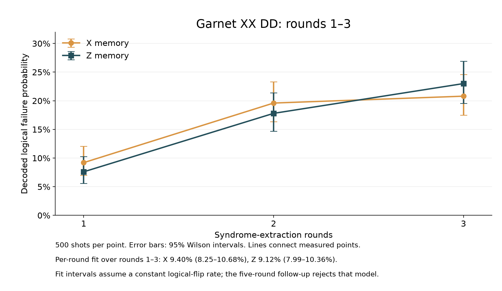
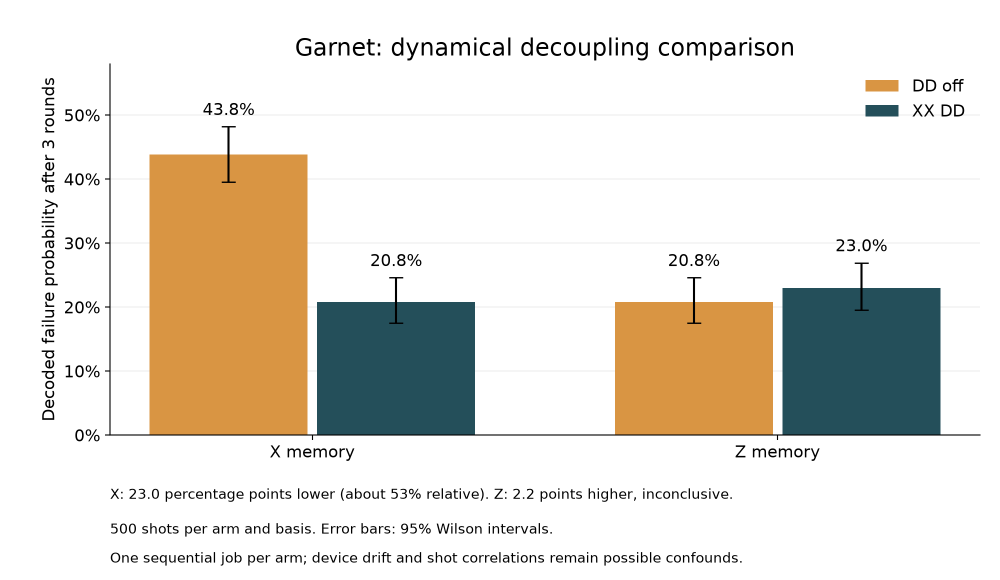

# Saved figures and experimental results

This directory collects the generated scientific plots, their numerical inputs,
saved circuit/decoder references, QPU results, circuit diagrams and presentation
previews from the Garnet study. No new QPU jobs were run to assemble it.

**Start with the corrected DD comparison and five-round follow-up.** The first
12,000-shot hardware run used different measurement grouping and is kept under
`historical/`; do not pool it with the later comparison.

## Main hardware figures

| Figure | What it shows | Supporting data |
|---|---|---|
| [Rounds 1–3 with XX DD](figures/rounds-1-to-3-xx-dd.png) ([SVG](figures/rounds-1-to-3-xx-dd.svg)) | X/Z cumulative decoded failure probabilities and Wilson intervals | [Point counts](hardware/dd-comparison/comparison-points.csv), [per-round fits](hardware/logical-rate-analysis/logical-error-rates.csv) |
| [DD benefit at three rounds](figures/dd-three-round-comparison.png) ([SVG](figures/dd-three-round-comparison.svg)) | DD-off versus XX-DD, with uncertainty for both bases | [Counts, intervals and adjusted tests](hardware/dd-comparison/comparison-points.csv) |
| [Full DD comparison over rounds 1–3](hardware/dd-comparison/dd-comparison.png) | Original two-panel comparison across all short round counts | [Report](hardware/dd-comparison/report.md), [analysis JSON](hardware/dd-comparison/comparison-results.json) |
| [Logical failure versus rounds and fits](hardware/logical-rate-analysis/logical-error-probability.png) | Separate short-range fits by basis and DD setting | [Rate table](hardware/logical-rate-analysis/logical-error-rates.csv), [full analysis](hardware/logical-rate-analysis/logical-error-rate-results.json) |
| [Logical fidelity](hardware/logical-rate-analysis/logical-fidelity.png) | Fidelity F = 1 − 2P and its fitted decay | [Report](hardware/logical-rate-analysis/report.md) |
| [Five-round follow-up](hardware/five-round-followup/five-round-followup.png) | Longer-run observations, short-range extrapolation and fit checks | [Points](hardware/five-round-followup/followup-points.csv), [analysis](hardware/five-round-followup/followup-analysis.json), [report](hardware/five-round-followup/report.md) |





At three rounds, XX-DD X-memory failures were 20.8%, compared with 43.8% with DD
off. The Z-memory difference was inconclusive. Both arms ran as sequential jobs,
so these binomial intervals and tests exclude possible device drift and shot
correlations. The fitted 1–3-round values are preliminary: X 9.40% per round and
Z 9.12%. Adding the five-round measurements rejects a constant stationary rate
for both bases. Cumulative failure probability P(r) and a fitted rate per round
are different quantities.

## Simulation and placement search

| Figure | Scope | Data and interpretation |
|---|---|---|
| [Z-memory simulation](simulation/z-memory/logical_failure_vs_rounds.png) | Baseline versus selected placement over round counts | [Points](simulation/z-memory/points.csv), [summary and search trace](simulation/z-memory/summary.json), [report](simulation/z-memory/report.md) |
| [X-memory simulation](simulation/x-memory/logical_failure_vs_rounds.png) | Baseline versus selected placement over round counts | [Points](simulation/x-memory/points.csv), [summary and search trace](simulation/x-memory/summary.json), [report](simulation/x-memory/report.md) |
| [Development smoke-test figure](simulation/smoke-test/logical_failure_vs_rounds.png) | Reduced-shot development run, not the final statistical study | [Configuration and counts](simulation/smoke-test/summary.json) |

The placement study screened all four valid zero-routing-SWAP maps using 10,000
simulated shots per map and basis at three rounds. The 200-step annealer reused
cached scores and agreed with exhaustive screening. Independent holdout used
100,000 shots for the baseline and 100,000 for the selected map, per basis.
Separate round sweeps used 100,000 shots per point. Across X and Z these two
saved runs contain 2,880,000 simulator shots, including 480,000 for screening
and holdout. This does not prove which map has the lowest true failure rate.

These simulation results use the earlier independent-reset Pauli model. They
exclude timed idle noise, DD refocusing, leakage and several hardware
correlations. The placement search was not repeated using the final
feedback-reset/DD hardware model.

## Historical hardware results

The [first 12,000-shot run](historical/first-qpu-run/report.md) predates the
measurement-grouping correction used for the matched DD experiment. Its
[hardware-versus-simulation plot](historical/first-qpu-run/hardware-vs-simulation.png),
[detector comparison](historical/first-qpu-run/detector-comparison.png),
[point data](historical/first-qpu-run/points.csv) and
[discrepancy diagnosis](historical/first-qpu-run/discrepancy-diagnosis.md)
are preserved as historical evidence. Statements about future work in those
dated reports describe the state when the reports were written.

## Circuit diagrams and interactive explanation

| Example | Timeline | Circuit and sample metadata |
|---|---|---|
| Initial surface-code example | [SVG](circuits/step1/timeline.svg) | [Folder](circuits/step1) |
| Integration example | [SVG](circuits/integration/timeline.svg) | [Folder](circuits/integration) |
| No-reset simulator comparison | [SVG](circuits/no-reset/timeline.svg) | [Folder](circuits/no-reset) |
| Noisy X-memory example | [SVG](circuits/x-noisy/timeline.svg) | [Folder](circuits/x-noisy) |

Download [surface-code-checks.html](interactive/surface-code-checks.html) and open
it locally to use the interactive stabilizer explanation. GitHub shows its source.
The no-reset circuit is an optional simulator example; the Garnet hardware path
uses measurement-conditioned resets.

The [dated zero-routing-SWAP audit](audit/zero-routing-swaps/assessment.md) and
[machine-readable evidence](audit/zero-routing-swaps/zero-swap-audit.json)
are also included. The separate five-round
[gate-circuit audit](hardware/five-round-followup/zero-swap-audit.json) concerns
the submitted native gates, not an inspection of server pulse playlists.

## Presentation

The [editable Google Slides deck](https://docs.google.com/presentation/d/1QSiCHPTnWuvSofX7tlzK8JEzmooYag8GfYD4jL5Vvbw/edit)
and [native chart workbook](https://docs.google.com/spreadsheets/d/1hD89054W71wTpySDI5FKoUAN_GjojPzenV3C2CdBLlA/edit)
retain their existing access settings. Repository copies include:

- [Current eight-slide previews](presentation/slides/README.md).
- [CSV exports of the three native chart tables](presentation/chart-data).
- [Superseded previews](presentation/archive), kept separately from current slides.
- [Garnet topology source image](presentation/assets/garnet-architecture-source.png),
  captured from IQM Resonance. The presentation background uses the supplied
  Slidesgo template with Flaticon/Freepik assets.

## Reproduce and verify

From the repository root, the two standalone presentation summary figures can be
regenerated without credentials, network access or new measurements:

```sh
python -m pip install -r requirements-sim.txt
python results/rebuild_summary_figures.py
```

The plot script reads the archived integer counts and Wilson intervals. It does
not rerun Monte Carlo, alter the saved observations or submit hardware work.
It produces PNG and SVG copies in `results/figures/`.

To re-decode the corrected short-round QPU records with the installed hardware
dependencies and create a fresh report outside this archive:

```sh
python analyze_logical_error_rate.py results/hardware/dd-comparison \
  --out output/redecoded-dd-report
```

Historical analysis scripts and `submitted-source/` directories retain their
original bytes, including original directory assumptions; they are provenance
snapshots. Use the commands above and the current root-level tools for new
analysis. See [HARDWARE.md](../HARDWARE.md) and [SIMULATION.md](../SIMULATION.md)
for full pipeline commands and model assumptions.

The [manifest](manifest.json) records source hashes and accounts for every
generated visual, including duplicate source copies. A separate
[file index](file-index.json) checksums every file in this archive except itself.
Duplicate graph copies appear once. Unrelated browser screenshots with personal
tabs, temporary preflight folders and scratch packaging files are excluded.
