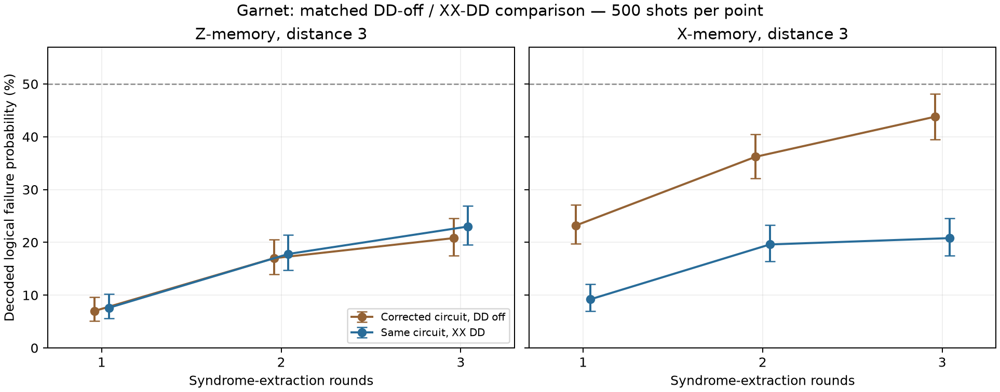

# Garnet DD-off versus XX-DD experiment

Both arms ran on real Garnet using identical corrected gate circuits, physical placements, measurement grouping, calibration UUID and shot counts. The arms differ in requested server-side DD configuration.

- Calibration UUID: `a18a947f-0408-4628-81ea-1715637e434f`.
- DD-off job: `01a17038-99ae-7572-8bb0-a0f98b62391f`.
- XX-DD job: `01a17039-46da-721d-8b3c-ba479ef0ca4d`.
- X/Z memories at 1, 2 and 3 rounds; 500 shots per point; 6,000 returned shots in total.
- XX targets the nine physical data qubits. Unique measurement records and reusable ancilla-feedback labels are preserved.

| Basis | Rounds | DD off | XX DD | DD minus control | Holm-adjusted p | Assessment |
|---|---:|---:|---:|---:|---:|---|
| Z | 1 | 7.0% | 7.6% | +0.6 pp | 1 | Inconclusive at this shot count |
| Z | 2 | 17.0% | 17.8% | +0.8 pp | 1 | Inconclusive at this shot count |
| Z | 3 | 20.8% | 23.0% | +2.2 pp | 1 | Inconclusive at this shot count |
| X | 1 | 23.2% | 9.2% | -14.0 pp | 9.82e-09 | DD lower failure |
| X | 2 | 36.2% | 19.6% | -16.6 pp | 2.45e-08 | DD lower failure |
| X | 3 | 43.8% | 20.8% | -23.0 pp | 4.68e-14 | DD lower failure |

Negative differences favor DD. Tests are two-sided Fisher exact tests with Holm correction across all six comparisons. Exact failure counts, Wilson intervals and unadjusted Newcombe intervals for differences are saved in comparison-results.json. Inconclusive results do not establish that DD has no effect.

## Interpretation and limits

The X-memory failure reductions are statistically significant at all three round counts after correcting the six tests. At three rounds the absolute reduction is 23.0 percentage points (unadjusted 95% interval: 17.3–28.5 points), or about 53% relative to the control. Z-memory differences are not statistically distinguishable from sampling fluctuations in this pilot.

This pattern is consistent with refocusable phase noise contributing to X-memory loss. It does not isolate a unique noise source. One job per arm was run sequentially; binomial intervals and tests do not account for drift or shot correlations. Repeated or interleaved paired runs would test reproducibility.

The hardware comparison addresses the requested compiler configuration. A verified DD-enabled flag does not prove which pulse sequences were inserted or how many eligible idle windows existed. The existing Stim baseline excludes timed idle noise, extra DD pulses and refocusing effects; its identical predictions for the two arms are expected by construction.

Only three short round counts were used. Per-arm challenge/SPAM fits are retained in each decoded-results.json, including goodness-of-fit flags; these should not be promoted to reliable stationary LERs when fit checks fail.

The earlier 12,000-shot experiment used different measurement grouping. Differences from that historical run cannot be attributed specifically to DD.

Saved evidence includes each arm's manifest, live architecture, native requests, QPY circuits, Stim/DEM references, validated counts, reconstructed samples and decoded results. The submitted-source directory preserves the implementation used for this comparison.

## Preliminary short-range fits

These fits use only 1, 2 and 3 rounds, with 500 shots per point. Passing a goodness-of-fit check with so few points does not establish a stationary long-duration memory rate. Intervals are conditional on the fitted model.

| Basis | DD | Fitted error per round | Conditional 95% interval | Fit p-value |
|---|---|---:|---:|---:|
| Z | off | 8.36% | 7.28–9.54% | 0.308 |
| Z | xx | 9.12% | 7.99–10.36% | 0.362 |
| X | off | 23.78% | 21.48–26.31% | 0.86 |
| X | xx | 9.40% | 8.25–10.68% | 0.137 |

The primary comparison is the observed per-experiment failure probabilities. Full challenge and SPAM fits remain in each arm’s decoded-results.json.
