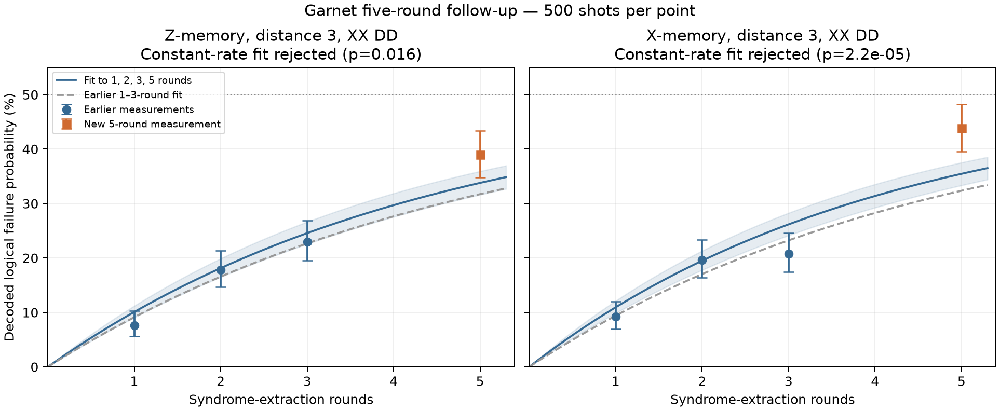

# Garnet five-round XX-DD follow-up

New real-QPU experiment: five rounds, X/Z memory, 500 shots per basis, 1,000 returned shots total. Earlier 1–3-round XX-DD measurements are reused for the explicitly combined fit; they are not new shots.

Calibration UUID: `a18a947f-0408-4628-81ea-1715637e434f`. New job: `01a170dc-141c-7179-8e99-814ac7642816`.

Completed successfully at 10:45:16 PM on October 24, 2026 New York time. All 1,000 requested shots returned.

Each five-round circuit uses 17 active qubits, 120 native CZ gates, 40 feedback resets, 49 measurements and 40 detectors. The independent gate-circuit audit verifies zero routing SWAPs, exact physical CZ pairs/multiplicities and measurement assignments. The returned native payload and requested DD configuration are verified.

| Basis | Failures / shots | Five-round failure probability | Wilson 95% interval | Earlier-fit prediction |
|---|---:|---:|---:|---:|
| Z | 195 / 500 | 39.0% | 34.8–43.3% | 31.7% |
| X | 219 / 500 | 43.8% | 39.5–48.2% | 32.4% |

The earlier-fit column is an extrapolation made from the previous 1–3-round data. Its value is not an independent measurement or an uncertainty interval.

## Combined fit across 1, 2, 3 and 5 rounds

Combining these particular jobs is explicit: the calibration UUID, physical maps, DD options, noise provenance, package versions and submitted implementation files match. These checks do not rule out time-dependent drift.

| Basis | Fitted error per round | Conditional 95% interval | Fit p-value | Model mismatch flag |
|---|---:|---:|---:|---|
| Z | 10.09% | 9.07–11.20% | 0.016 | True |
| X | 10.95% | 9.87–12.13% | 2.23e-05 | True |

The fit uses P(r) = [1 − (1 − 2ε)^r]/2 with binomial maximum likelihood. Full challenge and SPAM diagnostic fits are saved in followup-analysis.json. A mismatch flag means that a single stationary rate does not adequately explain the measured round dependence.

## Pulse-playlist interpretation

A playlist contains timed drive, coupler, readout and waiting instructions. The standard compiler resolves physically placed native gates into these schedules and can add DD pulses during eligible waits. Our circuit already uses native edges and requires no routing SWAPs; XX DD consists of single-qubit pulses and does not exchange states. Playlist inspection would establish detailed timing and DD insertion, which have not been audited here.

Compiler documentation: https://docs.iqm.tech/iqm-pulla/Configuration%20and%20Usage.html

## Limits

Sequential jobs, not interleaved; same calibration UUID does not exclude drift. Binomial/profile intervals exclude shot correlations, noise-model error and drift. Fits assume stationary independent logical flips. No new DD-off control was run.

The simulator baseline is the saved gate/readout Pauli model. It excludes timed idle noise, DD effects, leakage and several hardware correlations. Do not interpret it as a calibrated prediction of DD-enabled memory performance.

Saved counts were redecoded and reproduce the original failure counts. No additional shots were submitted by this analysis.

## Interpretation of the longer-round measurement

The five-round measurements lie above the extrapolations from the earlier short-round fit. The combined constant-rate model is rejected at the 5% level for Z, X memory. Its fitted rate parameters and conditional intervals are retained as diagnostics; they should not be presented as established stationary memory rates.

The two jobs were sequential. Greater degradation in longer circuits, leakage, other unmodeled correlations or drift between jobs could contribute; these data do not identify a unique cause. No five-round DD-off arm was measured, so this experiment alone cannot establish DD benefit at five rounds.
