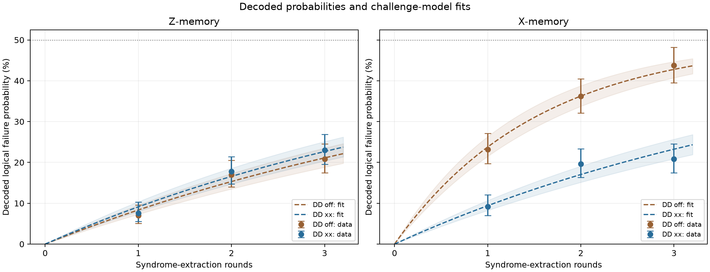
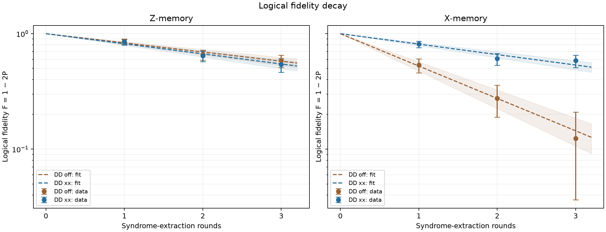

# Step 2: decoded logical error rates

Saved QPU counts were decoded again with PyMatching using each experiment's matching Stim measurement records and detector definitions. Re-decoded failure counts agree with the original results. Source data were preserved; copies are in redecoded-runs/.

A single experiment gives P_error after r rounds. The rate epsilon_L below is fitted across distinct round counts using:

$$P_{error}(r)=\frac{1-(1-2\epsilon_L)^r}{2},\qquad F(r)=1-2P_{error}(r).$$

The likelihood uses integer failure and shot counts. Point error bars are Wilson 95% intervals; rate intervals are approximate profile-likelihood intervals, conditional on the model.

| Run | Memory | DD | Round counts | Fitted error per round | Conditional 95% interval | Fit p-value | Fit check |
|---|---|---|---|---:|---:|---:|---|
| 1 | X | off | 1, 2, 3 | 23.78% | 21.48–26.31% | 0.86 | No mismatch detected |
| 1 | Z | off | 1, 2, 3 | 8.36% | 7.28–9.54% | 0.308 | No mismatch detected |
| 2 | X | xx | 1, 2, 3 | 9.40% | 8.25–10.68% | 0.137 | No mismatch detected |
| 2 | Z | xx | 1, 2, 3 | 9.12% | 7.99–10.36% | 0.362 | No mismatch detected |

These are per-round rates, distinct from the failure probabilities at any one round count. A good fit over three points has limited power to diagnose model failure; these short sweeps give preliminary estimates.

Dashed curves are challenge-model fits. Shading propagates each rate's 95% parameter interval into the curve; it is not a predictive interval or a calibration-error budget. Fidelity uses a logarithmic axis only when all plotted confidence bounds and model curves are positive. Negative fidelity estimates or bounds are retained on a linear axis.

## Preparation/readout diagnostic

A second fit permits a nonnegative preparation/readout offset s: P_error(r)=s+(1-2s)[1-(1-2epsilon_L)^r]/2. It is diagnostic and does not replace the challenge fit. Full values and intervals are in logical-error-rate-results.json.

- X, DD off: epsilon=23.78% per round; offset=0.00%; fit p=0.583.
- Z, DD off: epsilon=8.36% per round; offset=0.00%; fit p=0.125.
- X, DD xx: epsilon=8.83% per round; offset=1.29%; fit p=0.0514.
- Z, DD xx: epsilon=9.12% per round; offset=0.00%; fit p=0.154.

## Scope and reproducibility

- Groups from different runs, bases and DD settings are fitted separately.
- Three short round counts do not establish long-duration stationary memory performance.
- Confidence intervals exclude calibration, decoder-model and temporal-correlation uncertainty.
- The DD-on detector definitions remain valid for ideal identity sequences, but noise weights exclude the inserted DD pulses and idle errors.
- Round-count experiments can share an IQM batch; each circuit still has its own independent measurement records. Separate jobs are not required for the statistical fit.
- No network connection, credential or new QPU execution was used.

Sources:

- Run 1: /Users/mihailmircheski/Documents/ChatGPT/DuQuantum/output/garnet-dd-qpu-20261024/off; calibration a18a947f-0408-4628-81ea-1715637e434f; jobs: 01a17038-99ae-7572-8bb0-a0f98b62391f.
- Run 2: /Users/mihailmircheski/Documents/ChatGPT/DuQuantum/output/garnet-dd-qpu-20261024/xx; calibration a18a947f-0408-4628-81ea-1715637e434f; jobs: 01a17039-46da-721d-8b3c-ba479ef0ca4d.
