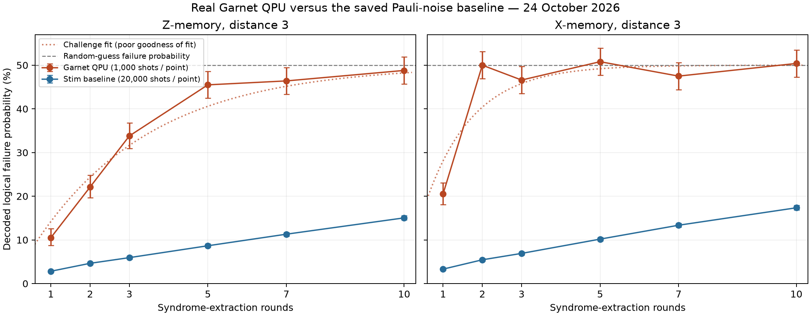
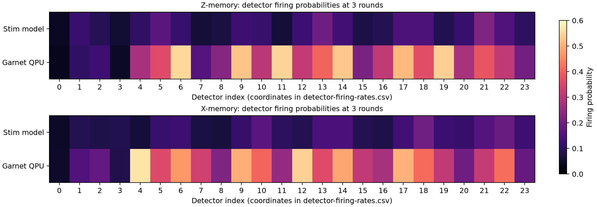

# Garnet QPU surface-code memory run — 24 October 2026

The full pipeline completed on real Garnet: native circuit preparation, QPU execution, raw measurement reconstruction, detector extraction, MWPM decoding and logical-decay fits.

- Completed job: `01a17013-83f6-76bf-a623-26360994c123`.
- Calibration set: `a18a947f-0408-4628-81ea-1715637e434f`.
- Distance 3, 17 active qubits, with ancilla feedback resets and zero routing SWAPs.
- X and Z memories; 1, 2, 3, 5, 7 and 10 rounds; 1,000 shots per point; 12,000 returned shots.
- All returned native circuit names and instructions exactly match the saved request after JSON container normalization. All measurement widths, calibration IDs and shot totals passed verification.

## Observed failure probabilities

| Rounds | Z: QPU | Z: simulation | X: QPU | X: simulation |
|---:|---:|---:|---:|---:|
| 1 | 10.5% | 2.82% | 20.5% | 3.31% |
| 2 | 22.1% | 4.63% | 50.0% | 5.44% |
| 3 | 33.8% | 5.93% | 46.6% | 6.91% |
| 5 | 45.5% | 8.65% | 50.8% | 10.17% |
| 7 | 46.4% | 11.30% | 47.5% | 13.36% |
| 10 | 48.8% | 15.04% | 50.4% | 17.35% |

These are decoded failure probabilities after the stated number of rounds. Values slightly above 50% are compatible with finite sampling around random-guess performance. Exact counts and Wilson 95% intervals are in points.csv.

## Fit quality

| Basis | Challenge fit: error per round | Conditional 95% interval | Goodness-of-fit p-value | Assessment |
|---|---:|---:|---:|---|
| Z | 14.20% | 13.30–15.16% | 4.04e-05 | Poor fit |
| X | 28.09% | 26.27–30.03% | 4.92e-14 | Poor fit |

**Both decay models fail goodness-of-fit checks. The fitted rates and intervals must not be interpreted as reliable stationary hardware LERs.** Allowing the positive initialization/readout offset also fails for both bases and yields its best fit at zero offset.

X-memory is near random-guess performance from two rounds onward. Z-memory progressively approaches that level. This is substantially worse than the saved simulation baseline. The run establishes that the pipeline executes and returns verified data; it does not demonstrate useful logical-memory protection or breakeven.

## Detector and decoder diagnostics

| Experiment | Raw observable flips | Decoded failures | Mean detector firing | Model mean detector firing |
|---|---:|---:|---:|---:|
| Z, 1 rounds | 17.5% | 10.5% | 15.4% | 10.2% |
| Z, 3 rounds | 36.9% | 33.8% | 31.9% | 11.3% |
| Z, 10 rounds | 50.1% | 48.8% | 38.1% | 12.1% |
| X, 1 rounds | 26.2% | 20.5% | 18.3% | 10.1% |
| X, 3 rounds | 47.9% | 46.6% | 33.0% | 11.2% |
| X, 10 rounds | 50.5% | 50.4% | 39.1% | 12.1% |

The detector discrepancy is diagnostic evidence, not an attribution of its cause. The current Pauli model excludes idle T1/T2 noise, leakage, measurement disturbance, crosstalk and coherent errors. Its residual reset error is assumed, and decoder weights are derived from the same approximate benchmark model.

## Integration issues resolved

- Authentication: IQM Client rejects giving the same token through both the environment and constructor arguments. The code now uses one source.
- Initial job `01a17010-f5d2-749d-8c6b-2ffd10ccb4ce` failed instrument compilation before execution because multiple feedback labels were used per ancilla drive. Its request, ledger and compiler diagnostics are preserved in the sibling garnet-qpu-full-20261024 directory.
- The successful request reuses a single real-time feedback signal per ancilla while retaining every unique stored measurement key. All quantum operations and result keys match the original request.
- IQM Client 35 returned generic Qiskit header names for dictionary-form circuit payloads. Collection now verifies full native payload identity before accepting those headers. The completed job was retrieved again; it was not resubmitted.

## Next diagnostics before more surface-code QPU shots

1. Characterize repeated ancilla measurement and feedback reset on the used qubits.
2. Inspect actual cycle durations, readout multiplexing/serialization and feedback latency; update the baseline with timed data-qubit idle noise.
3. Check both logical signs in X/Z and compare against unencoded memory for the same elapsed time.
4. Evaluate pulse simplification and dynamical decoupling with a corresponding updated reference and noise model.

No further QPU shots were launched for these diagnostics.

## Saved evidence

- manifest.json: job ledger, mappings, audits and simulation provenance.
- request-0.json and architecture.json: submitted native request and live target.
- result-0.json: validated counts, returned header names and payload-verification flags.
- unvalidated-result-0.json and job-status-0.json: original returned payload and job status evidence.
- decoded-results.json and simulation-fits.json: hardware and simulator fits.
- points.csv, detector-firing-rates.csv and samples-*.npz: point statistics and reconstructed records.
- *.qpy, *.stim and *.dem: compiled circuits, exact decoder references and error models.

## Follow-up diagnosis

See [discrepancy-diagnosis.md](discrepancy-diagnosis.md) for confirmed findings, hypotheses, and the locally tested measurement-grouping correction. The correction was made after this run and has not been tested on the QPU.
